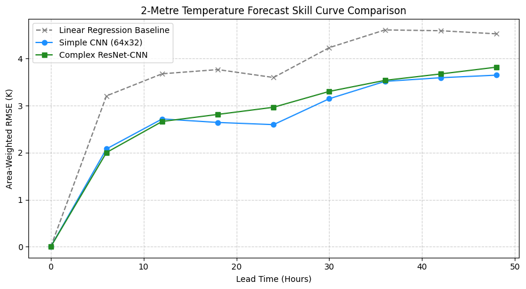

# WeatherBench Forecaster

A learning project in **machine-learning weather prediction**. It trains small neural networks to forecast the global atmosphere from [ERA5](https://www.ecmwf.int/en/forecasts/dataset/ecmwf-reanalysis-v5) reanalysis data and scores them with the [WeatherBench 2](https://sites.research.google/gr/weatherbench/) benchmark ([code](https://github.com/google-research/weatherbench2)). That's the same protocol used to evaluate GraphCast, Pangu-Weather and ECMWF's physics-based IFS.

Everything runs on free GPUs (Google Colab T4 or Kaggle). The goal is to understand the techniques, not to beat state-of-the-art models.

## How it works

1. **Data.** WeatherBench 2 hosts ERA5 regridded to a coarse **64 × 32 global grid (5.625°, ~600 km cells) every 6 hours**, from 1959 to 2023, in a public Zarr store on Google Cloud Storage. We stream a subset of variables and stack them into a `(time, channel, lat, lon)` array, e.g. 2 m temperature and 500 hPa geopotential.
2. **Normalization.** Each channel is z-scored with means and standard deviations computed on the training years only.
3. **Model.** A convolutional network maps the state at time *t* to the state at *t* + 6 h. The convolutions use **periodic padding in longitude**, because the globe wraps around at 0°/360°. The CNNs are *residual*: they predict the change, not the full field.
4. **Training.** Minimize the MSE between the predicted and actual next state over consecutive 6-hour pairs.
5. **Autoregressive rollout.** To forecast 48 h ahead, apply the model 8 times, feeding each prediction back in as the next input. This is how GraphCast and friends work too.
6. **Evaluation.** Forecasts are exported in WB2's `(time, prediction_timedelta, [level], latitude, longitude)` Zarr format and scored against ERA5 with the official `weatherbench2/scripts/evaluate.py`. It reports area-weighted RMSE, bias and ACC, plus persistence and climatology baselines.

## Results so far (v0)

[`notebooks/01_t2m_z500_model_comparison.ipynb`](notebooks/01_t2m_z500_model_comparison.ipynb) compares three models trained on 2018 and tested on 1–15 Jan 2020:

| Model | Description |
|---|---|
| Linear | A single 5×5 periodic convolution, no nonlinearity |
| Simple CNN | 3 conv layers, GELU, residual |
| Complex CNN | ResNet-style blocks plus a dilated block for a larger receptive field |



The CNNs clearly beat the linear model. **But at 24 h they're still worse than simply persisting the initial state** (WB2 persistence T2M RMSE at 24 h: 1.74 K; climatology: 2.40 K). The main reasons: the model has no knowledge of the time of day or season, it sees only two variables, and it was trained only on single steps. The [roadmap](docs/ROADMAP.md) has the full diagnosis and fixes.

## Roadmap

[`docs/ROADMAP.md`](docs/ROADMAP.md) is a phased plan from this toy to a ~40-variable global model with ensembles, all on free compute:

1. Honest evaluation: baselines, standard splits, 10-day rollouts
2. Forcings (solar radiation, time, orography) and a latitude-weighted loss
3. A full atmospheric state: z, t, u, v, q on 7 levels plus surface fields
4. Architectures: U-Net, Vision Transformer, Spherical Fourier Neural Operator
5. Multi-step rollout training, plus diagnosing forecast blurring
6. Probabilistic ensembles: CRPS and the spread/skill ratio
7. Case studies (2021 Pacific NW heat dome) and a write-up
8. Live forecasts on a website ([`docs/WEBSITE.md`](docs/WEBSITE.md))

## Repository layout

```
├── notebooks/
│   └── 01_t2m_z500_model_comparison.ipynb   # v0: three models, WB2 evaluation, skill curves (Colab)
├── src/wbforecaster/                        # reusable code, importable in Colab or locally
│   ├── data.py       # open WB2 ERA5, extract channels ("geopotential@500"), normalizer, dataset
│   ├── models.py     # PeriodicConv2d, Linear / Simple CNN / Complex CNN
│   └── forecast.py   # training loop, autoregressive rollout, export to WB2 Zarr format
├── scripts/
│   ├── train_and_forecast.py   # CLI: train → rollout → write forecast .zarr
│   └── evaluate.sh             # run the official WB2 evaluation (optionally with baselines)
└── docs/
    ├── ROADMAP.md    # learning plan
    ├── WEBSITE.md    # how to serve forecasts on a website
    └── images/
```

## Running it

### In Google Colab (recommended, free T4 GPU)

Open the notebook straight from GitHub: **File → Open notebook → GitHub**, tick *Include private repos*, and choose this repo. Set **Runtime → Change runtime type → T4 GPU**. Use **File → Save a copy in GitHub** to commit changes back.

To use the `wbforecaster` package from Colab, store a read-only GitHub token as a Colab Secret named `GH_TOKEN`, then run:

```python
from google.colab import userdata
token = userdata.get("GH_TOKEN")
!git clone -q https://{token}@github.com/willBennatt/weather-bench-forecaster.git
!pip install -q -e weather-bench-forecaster
!git clone -q https://github.com/google-research/weatherbench2.git && pip install -q -e weatherbench2
```

### Locally or in Colab via the CLI

```bash
pip install -e .
```

```bash
python scripts/train_and_forecast.py --model simple --output forecast_simple.zarr
```

Pick variables with `--channels` (pressure levels use `var@level`):

```bash
python scripts/train_and_forecast.py --model complex --channels 2m_temperature geopotential@500 temperature@850 --epochs 10 --output forecast_complex.zarr --checkpoint complex.pt
```

Evaluate with the official WeatherBench 2 script. It needs a checkout of `weatherbench2` installed with `pip install -e`. `BASELINES=1` also scores persistence and climatology:

```bash
BASELINES=1 scripts/evaluate.sh forecast_simple.zarr eval_results_simple/ 2m_temperature,geopotential 500
```

Results are written to `eval_results_simple/deterministic.nc`.

## Data and acknowledgements

- ERA5 reanalysis: Hersbach et al. 2020, Copernicus Climate Change Service.
- WeatherBench 2: Rasp et al. 2024, *JAMES*. Data at `gs://weatherbench2` (public, no credentials needed).
