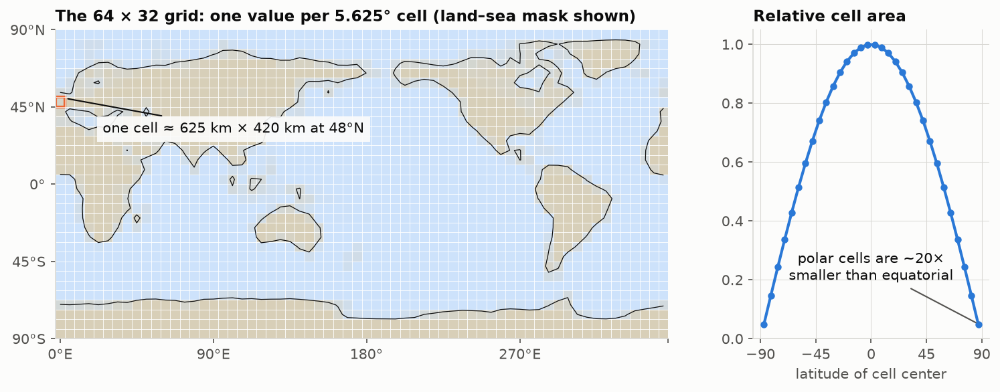
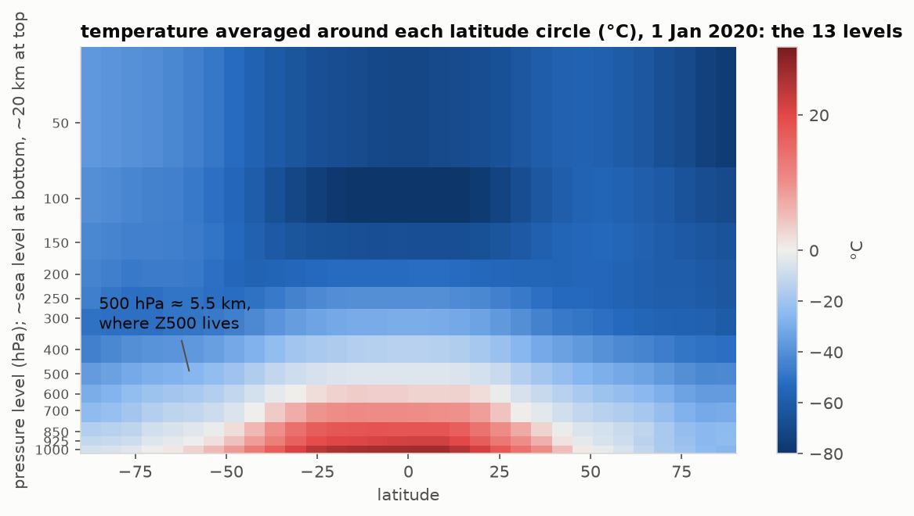
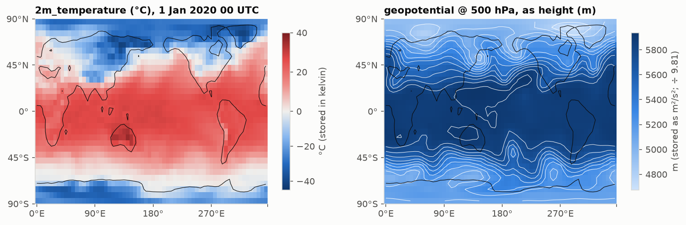
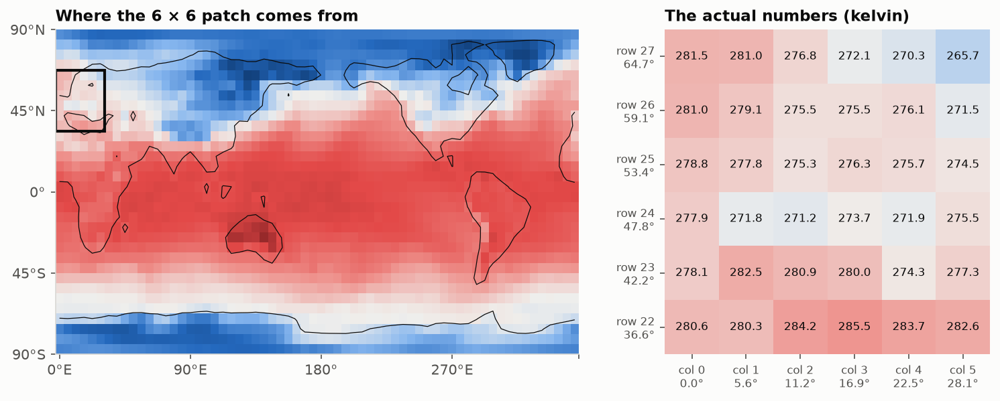
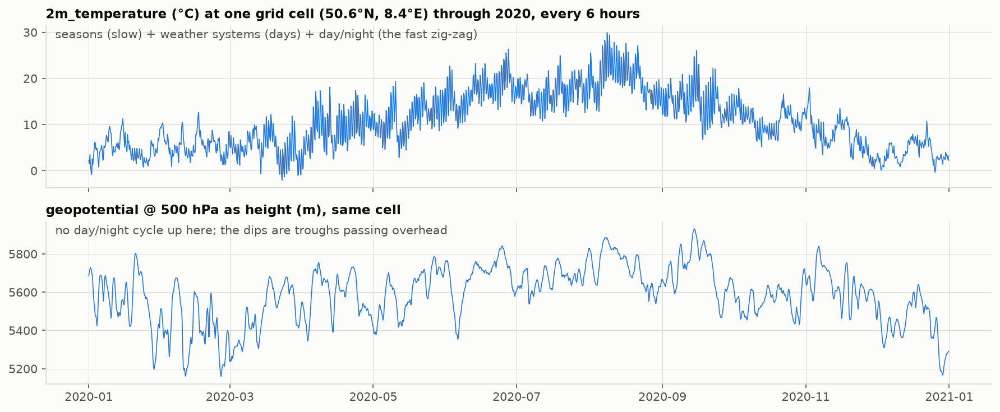
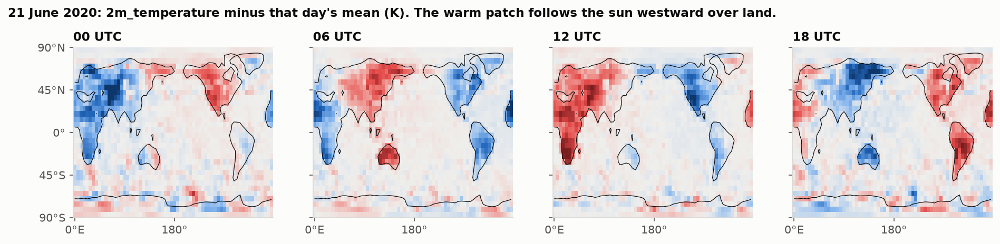
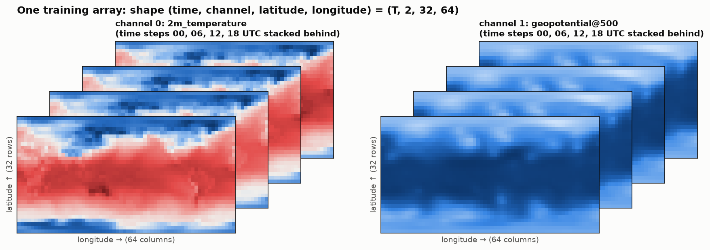
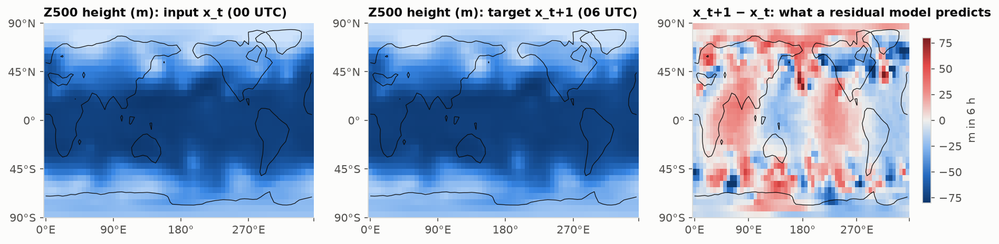
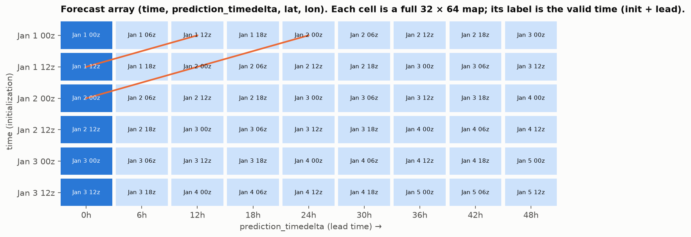

# The WeatherBench 2 data, and what the arrays look like

This page walks through the data this project trains on: where it comes from, how it's laid out on disk, and what the arrays look like at each step from the Zarr store to the model's input and the forecast it writes out. The figures come from [`scripts/make_data_figures.py`](../scripts/make_data_figures.py), using the local cache from `download_era5.py`.

## Where the data comes from

**ERA5** is ECMWF's *reanalysis*: a modern weather model run over the past, pulling in every available historical observation (weather stations, balloons, satellites, aircraft, ships). It gives the best available estimate of the whole atmosphere, hour by hour, from 1940 to the present, at 0.25° resolution (~28 km). It's the ground truth used to train and score nearly every ML weather model.

**WeatherBench 2** (Google Research) republishes ERA5 in ML-friendly form in a public Google Cloud bucket (`gs://weatherbench2`, no account needed). It comes regridded to several resolutions and comes with evaluation code, climatology files and other models' forecasts for comparison.

| Grid | Cell size | Values per field | Typical use |
|---|---|---|---|
| **64 × 32** (this project) | 5.625° ≈ 625 km | 2,048 | Learning, fast experiments |
| 128 × 64 | 2.8° | 8,192 | |
| 240 × 121 | 1.5° | 29,040 | WB2 headline scores |
| 1440 × 721 | 0.25° ≈ 28 km | 1,038,240 | GraphCast, Pangu, IFS |

This project uses `gs://weatherbench2/datasets/era5/1959-2023_01_10-6h-64x32_equiangular_conservative.zarr`. The name says: years 1959 to 10 Jan 2023, a snapshot every **6 hours** (93,544 time steps), on an **equiangular** 64 × 32 grid, regridded **conservatively**. Conservative regridding means each coarse cell is the area-average of the fine cells inside it, not a sample at one point.

## The grid



- **Longitude:** 64 columns at 0°, 5.625°, … 354.375°E. Column 0 is the Greenwich meridian, and column 63 sits right next to column 0 on the globe. That's why the CNNs use **circular padding** in longitude: the array wraps around.
- **Latitude:** 32 rows at cell centers −87.1875° … +87.1875°, stored **south to north**: row 0 is the southern edge. This grid has no row at the poles themselves.
- **Cells aren't equal in size.** Each cell spans 5.625° of longitude, but a degree of longitude shrinks toward the poles: by cos(latitude). A polar row's cells are ~20× smaller than an equatorial row's. WB2 scores are area-weighted for this reason. An unweighted training loss gives polar cells far more influence than the area they cover (Phase 2).

## The variables

The store has 62 variables of three kinds:

| Kind | Shape on disk | Examples |
|---|---|---|
| **Pressure-level** (3-D atmosphere) | `(time, level, longitude, latitude)` | `geopotential`, `temperature`, `u_component_of_wind`, `v_component_of_wind`, `specific_humidity`, `vertical_velocity`, `relative_humidity`, `vorticity`, `divergence`, `potential_vorticity` |
| **Surface / single-level** | `(time, longitude, latitude)` | `2m_temperature`, `mean_sea_level_pressure`, `10m_u_component_of_wind`, `10m_v_component_of_wind`, `total_precipitation_6hr`, `total_cloud_cover`, `sea_surface_temperature`, `surface_pressure` |
| **Static** (never change) | `(longitude, latitude)` | `land_sea_mask`, `geopotential_at_surface` (orography × g), `soil_type`, `lake_cover` |

The **13 pressure levels** are 50, 100, 150, 200, 250, 300, 400, 500, 600, 700, 850, 925 and 1000 hPa. Pressure falls with height, so the levels are a stack of surfaces from near sea level (1000 hPa) up to ~20 km (50 hPa):



Temperature falls with height through the troposphere. Above the tropopause it stops falling, and the coldest air in the column sits ~16 km above the equator (100 hPa), not over the poles.

The two channels in v0:



- **`2m_temperature`** is air temperature 2 m above the ground, in **kelvin** (0 °C = 273.15 K). It follows the land and the seasons: January means Siberia and Canada are deeply cold while Australia bakes.
- **`geopotential` at 500 hPa ("Z500")** is the gravitational potential energy (m²/s²) of the surface where pressure is 500 hPa. Divide by g = 9.81 to get its height, ~5,000–5,900 m. Low heights (light) mark cold air and **troughs**, the dips in the jet stream that come with storms. High heights (dark) mark warm air and **ridges**. Z500 is the classic headline variable for medium-range skill because it captures the large-scale flow pattern.

Other units to watch for: winds in m/s, `specific_humidity` in kg/kg (tiny numbers, ~0.001–0.02), `mean_sea_level_pressure` in Pa (~101,325), and precipitation in **metres** of water.

## How it's stored: Zarr chunks

Zarr splits each variable into compressed **chunks**, stored as separate files that can be read independently. In this store every chunk is **100 time steps × all 13 levels × the full globe**:

```python
import xarray as xr
ds = xr.open_zarr("gs://weatherbench2/datasets/era5/1959-2023_01_10-6h-64x32_equiangular_conservative.zarr",
                  storage_options={"token": "anon"})
ds["geopotential"]        # dims (time, level, longitude, latitude), shape (93544, 13, 64, 32)
ds["geopotential"].encoding["chunks"]   # (100, 13, 64, 32): ~7.7 MB compressed per chunk
```

Two practical consequences:

- **Opening is lazy.** `open_zarr` reads only metadata. Data is downloaded when you call `.values` or `.load()`.
- **You download whole chunks.** Selecting `level=500` still fetches all 13 levels, because they share a chunk. That's why `download_era5.py` exists: it downloads once and keeps only the levels you asked for. The local cache is ~19 MB/year for T2M + Z500, versus ~110 MB/year streamed.

Note the on-disk order is `(time, longitude, latitude)`. `extract_channels` transposes to `(time, latitude, longitude)`, the usual image layout of rows × columns.

## What the numbers actually are

Each field at one time step is just a 32 × 64 grid of floats. Here's a 6 × 6 corner of `2m_temperature` at 00 UTC on 1 Jan 2020, covering western/central Europe:



Printed directly:

```python
>>> ds["2m_temperature"].sel(time="2020-01-01T00").transpose("latitude", "longitude").values[22:28, 0:6].round(1)
array([[280.6, 280.3, 284.2, 285.5, 283.7, 282.6],   # row 22, 36.6°N
       [278.1, 282.5, 280.9, 280.0, 274.3, 277.3],   # row 23, 42.2°N
       ...
       [281.5, 281.0, 276.8, 272.1, 270.3, 265.7]],  # row 27, 64.7°N
      dtype=float32)
```

Each value is the *average* over a ~625 km cell, so a whole country might be two or three numbers. Mountains, coastlines and cities all blur together.

## Time: two kinds of signal

Snapshots are 6 hours apart (00, 06, 12, 18 UTC). Here is one grid cell over central Europe through all of 2020:



T2M mixes three timescales: the **seasonal cycle**, **weather systems** lasting a few days, and the **day/night cycle** (the zig-zag between consecutive 6-hour samples). Z500 has no day/night signal. Its swings are troughs and ridges passing overhead.

The day/night cycle is the same everywhere: a wave of afternoon warmth moving west with the sun. Each panel below subtracts that day's mean:



The colour scale runs from −8 K (blue) to +8 K (red). Land swings by several kelvin between night and day; the ocean hardly changes. **This is exactly what v0 can't predict.** Its input contains no information about where the sun is, so it can't know which side of the globe is about to warm up. Phase 2 adds solar radiation and time-of-day as inputs.

## From the store to the model's input

`extract_channels` stacks the chosen channels into one float32 array:



| Data | Shape | Size |
|---|---|---|
| Training, 1979–2015, T2M + Z500 | (54056, 2, 32, 64) | 0.89 GB |
| Same, 39 channels (Phase 3) | (54056, 39, 32, 64) | 17 GB as float32, 8.6 GB as float16 |

**Normalization.** The channels have wildly different scales, so `Normalizer` z-scores each one with means and standard deviations from the training years only. For 1979–2015:

| Channel | Mean | Std dev | Std dev of the 6-hour *change* | Change ÷ field std dev |
|---|---|---|---|---|
| `2m_temperature` | 278.6 K | 20.9 K | 2.33 K | 0.11 |
| `geopotential@500` | 54,113 m²/s² | 3,338 m²/s² | 223 m²/s² | 0.067 |

The last column is the important one. In normalized units, the atmosphere changes very little in 6 hours, so the "do nothing" model (output = input, i.e. persistence) already has a training MSE of about (0.11² + 0.067²) / 2 ≈ **0.0085**. v0's simple CNN reaches about 0.007, only ~15% better than doing nothing. That's why the CNNs are *residual* (`x + net(x)`): the network only has to learn the small change. It's also why GraphCast normalizes the *change* by its own standard deviation, so the loss focuses on what actually happens in 6 hours.

## A training example

Each training example is a pair: the state at time *t* and the state 6 hours later.



Input and target look nearly identical. All the signal is in the difference on the right, which is what the residual model has to learn. The moving troughs show up in mid-latitudes as paired positive/negative patches. The broad bands in the tropics are a daily **atmospheric tide**, a pressure wave driven by solar heating: one more reason the model needs to know the time of day.

## The forecast format WB2 expects

A rollout produces one 10-day forecast from each initialization time. WB2 wants them as `(time, prediction_timedelta, [level], latitude, longitude)`, where `time` is the **initialization** time and `prediction_timedelta` the **lead time**:



- Every cell is a whole 32 × 64 map. The label is the **valid time** = init + lead: the moment the map describes, and the moment of the ERA5 snapshot it gets scored against.
- The first column (lead 0) is the initial state copied from ERA5, so its error is 0.
- The orange diagonals join cells that describe the same moment, predicted from different starting points and lead times.
- With `--init-hours 0 12`, 2020 gives 732 rows × 41 lead times (0–240 h). For two channels that's ~0.5 GB.

Both baselines fit this same array:

- **Persistence** copies the lead-0 column across every lead (`scripts/make_persistence.py`).
- **Climatology** fills each cell with the 1990–2019 average for that valid time's day of year and hour. That's the `era5-hourly-climatology` store, with dims `(hour, dayofyear, longitude, latitude)` = (4, 366, 64, 32).

Why is climatology's error the same at every lead time? Look at what it fills each cell with. Answering that is one of the Phase 1 goals.
