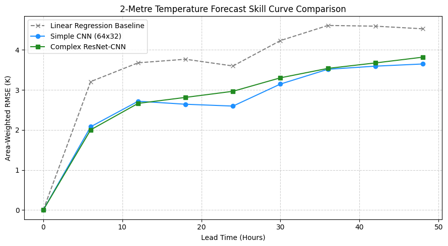

# Roadmap: from a 2-variable toy to a full (small) global weather model

The goal is to learn the techniques behind modern ML weather models (GraphCast, Pangu, FourCastNet, NeuralGCM) on a budget of **$0–20**, using free Colab/Kaggle GPUs and the 64×32 (5.625°) WeatherBench 2 data. The forecasts won't be competitive. What matters is that each phase teaches a real technique, and that you score every result honestly with the WeatherBench 2 protocol.

Each phase is sized to fit a few free GPU sessions. Do them in order: each one fixes a weakness you can see in the previous phase's results.

---

## Where v0 stands, and what it's telling you

v0 ([notebook](../notebooks/01_t2m_z500_model_comparison.ipynb)) trains three models on one year (2018) of T2M + Z500. It rolls them out to 48 h over 1–15 Jan 2020.



Here are the published WeatherBench 2 scores at the same 64×32 resolution (global RMSE over all of 2020, from `gs://weatherbench2/benchmark_results/*_vs_era5_64x32_2020.nc`):

| Model | Z500 RMSE (m²/s²) day 1 / 3 / 5 / 10 | T850 (K) | T2M (K) |
|---|---|---|---|
| Persistence (forecast = initial state) | 579 / 929 / 1022 / 1100 | 2.72 / 4.02 / 4.29 / 4.53 | 1.74 / 2.64 / 2.92 / 3.21 |
| Climatology (forecast = long-term average) | 800 / 801 / 802 / 803 | 3.24 | 2.40 |
| Keisler 2022 (GNN, the first "good" ML model) | 57 / 161 / 328 / 761 | 0.54 / 0.95 / 1.60 / 3.30 | – |
| Pangu-Weather | 39 / 122 / 277 / 753 | 0.41 / 0.80 / 1.43 / 3.26 | 0.38 / 0.68 / 1.13 / 2.41 |
| GraphCast | 35 / 113 / 258 / 709 | 0.36 / 0.71 / 1.30 / 3.10 | 0.35 / 0.60 / 1.00 / 2.30 |
| ECMWF IFS HRES (physics model) | 42 / 125 / 287 / 777 | 0.52 / 0.89 / 1.52 / 3.35 | 0.69 / 0.88 / 1.23 / 2.39 |

**The lesson: at 24 h, v0's T2M error (~2.6 K) is worse than persistence (1.74 K) and climatology (2.40 K).** The test window is only two weeks in January, so the numbers don't compare exactly, but the gap is large. Every one of the main causes is a standard technique you'll learn in the phases below:

1. **The model doesn't know the time of day or the season.** T2M has a strong day/night cycle, and the model has no idea where the sun is. That explains the zig-zag in the curve, and why 24 h (same time of day) beats 18 h. → Phase 2
2. **Two variables don't form a closed system.** Surface temperature depends on winds, humidity, clouds and the sun. Z500 alone can't predict it. → Phase 3
3. **One-step training, multi-step use.** The model only ever learned 6-hour steps, so its errors compound during the rollout. → Phase 5
4. **Unweighted loss.** On a lat/lon grid, polar cells cover far less area than equatorial ones. WB2 metrics are area-weighted (cos latitude), but the training loss isn't. → Phase 2
5. **Little data, no validation set, short test.** One training year, no held-out year for model selection, and two weeks of testing. → Phase 1

---

## Phase 1: Honest evaluation and data hygiene (CPU is enough)

**You learn:** forecast verification, baselines, skill scores, train/val/test discipline.

- Run [`scripts/evaluate.sh`](../scripts/evaluate.sh) with `BASELINES=1`. It scores persistence and climatology over the same period as your forecast.
- Download the published WB2 result files (table above) and plot your curves on the same axes as persistence, climatology, Keisler and HRES. They're NetCDF3: `xr.open_dataset(path, engine="scipy")`, with variables like `rmse.geopotential` and `lead_time` in hours.
- Adopt the standard WB2 splits: **train 1979–2015, validate 2016–2017, test 2020** (with 00z and 12z initializations, so 732 forecasts). Pick models by validation score. Look at the test set only for the final numbers.
- Extend rollouts to **10 days (40 steps)**. Error growth over days 3–10 is where weather becomes interesting.
- Also look at **ACC** (anomaly correlation coefficient) for Z500. Meteorologists treat ACC > 0.6 as the threshold of "useful skill".
- **Cache the data.** Streaming from GCS on every run is slow. Download once to Google Drive as `.npy` or a local Zarr store, then load from Drive.

**Done when:** you have a plot of your model vs persistence vs climatology over a full year, and you can explain why climatology's RMSE is flat.

## Phase 2: Forcings and an area-weighted loss

**You learn:** inputs vs. outputs (prognostic vs. forcing variables), static fields, physically motivated loss design.

- Add **forcing inputs**. The model receives them but doesn't predict them:
  - Top-of-atmosphere incoming solar radiation. Compute it analytically from latitude, longitude and time (a ~20-line solar geometry function), so it's available at any future time.
  - sin/cos of time of day and day of year.
  - Static fields from the same Zarr store: `land_sea_mask`, `geopotential_at_surface` (orography), and latitude.
- **Latitude-weight the loss** by `cos(lat)` so it matches how WB2 scores you.
- Retrain the v0 setup. The diurnal zig-zag should mostly disappear, and T2M should beat persistence at short leads.

**Done when:** T2M at 6–24 h beats persistence.

## Phase 3: A full atmospheric state ("the full weather forecast")

**You learn:** what variables define the atmosphere's state, multi-channel normalization, memory-efficient data pipelines.

Use roughly this channel set, a cut-down version of what GraphCast and Keisler use:

| Type | Variables | Levels (hPa) | Channels |
|---|---|---|---|
| Pressure-level | `geopotential`, `temperature`, `u_component_of_wind`, `v_component_of_wind`, `specific_humidity` | 50, 250, 500, 700, 850, 925, 1000 | 35 |
| Surface | `2m_temperature`, `10m_u_component_of_wind`, `10m_v_component_of_wind`, `mean_sea_level_pressure` | – | 4 |
| Forcings (input only) | solar radiation, time features, land-sea mask, orography | – | ~6 |
| Optional diagnostic (output only) | `total_precipitation_6hr` | – | 1 |

`wbforecaster.data.extract_channels` already accepts this format, e.g. `--channels geopotential@500 temperature@850 2m_temperature ...`. The export in `to_wb2_dataset` groups levels automatically.

- **Memory budget:** 1979–2017 at 6-hourly steps is ~57k time steps × 39 channels × 2048 grid cells. That's ~9 GB as float16, which is too much for Colab's ~12 GB of RAM once you add overhead. Options:
  - Train on 2000–2017 (~4 GB as float16).
  - Use `np.memmap` from Colab's local disk.
  - Stream batches from a Zarr store chunked by time.

  Free Google Drive is 15 GB, so cache only what you need.
- **Normalization:** normalize each variable and level separately. Then try the GraphCast trick: have the network predict the *tendency* (x_{t+1} − x_t), normalized by the standard deviation of the tendencies rather than of the fields.
- **Per-variable loss weights.** Otherwise the loss gets dominated by the variables that are easiest to fit.
- **Score the WB2 headline variables:** Z500, T850, Q700, wind vector at 850, T2M, MSLP, 10 m wind.

**Done when:** you have a scorecard (a heatmap of RMSE relative to persistence, by variable and lead time) for a 39-channel model.

## Phase 4: Architectures (one notebook each)

**You learn:** the main architecture families in ML weather prediction, and why each one exists.

At 64×32, each of these trains in roughly 1–4 hours on a T4 with mixed precision (`torch.autocast(dtype=torch.float16)`):

1. **U-Net with periodic padding.** Captures multiple scales by downsampling 64×32 → 32×16 → 16×8 → 8×4. This is the natural next step from the current CNNs.
2. **Vision Transformer (ClimaX/Stormer-style).** 2×2 patches give 512 tokens, which fits easily. It teaches attention and positional encoding.
3. **Spherical Fourier Neural Operator (SFNO)** via [`torch-harmonics`](https://github.com/NVIDIA/torch-harmonics) (used in FourCastNet v2). It respects the sphere's geometry and stays stable over long rollouts.
4. *(Stretch)* **Graph network on an icosahedral mesh** (Keisler 2022, GraphCast-lite), with PyTorch Geometric. This is the hardest one.

**Done when:** your scorecard compares at least the CNN, the U-Net and one of the ViT/SFNO models.

## Phase 5: Training for long rollouts

**You learn:** autoregressive training, error accumulation, and the "blurring" problem.

- **Multi-step fine-tuning.** After one-step training, unroll 2 → 4 → 8 steps and backpropagate through the whole rollout (GraphCast's curriculum goes up to 12 steps). Expect a large improvement at days 3–10.
- Standard training improvements: learning-rate warmup + cosine decay, gradient clipping, and EMA (exponential moving average) of the weights.
- **Checkpoint and resume.** Save to Drive every N minutes so that a Colab disconnect doesn't lose your run.
- **Diagnose blurring.** MSE-trained models get smoother as lead time grows, because they're hedging toward the mean. Compute zonal energy spectra (WB2 has `scripts/compute_zonal_energy_spectrum.py`) and plot forecast vs. ERA5. This is a key scientific discussion point.

**Done when:** you can show and explain the spectra plot, and Z500 RMSE at day 5 improves after multi-step fine-tuning.

## Phase 6: Probabilistic forecasting

**You learn:** ensembles, chaos and predictability, and proper scoring rules.

- Build a cheap ensemble: perturb the initial conditions and/or train 4–8 models with different seeds. Then score the ensemble mean (RMSE) and the full ensemble (**CRPS**, **spread/skill ratio**). WB2's evaluation supports ensembles (`--ensemble_dim`).
- Connect it to theory: Lorenz's limit on predictability, and why the ensemble mean beats any single member after a few days.
- *(Stretch)* Train a model directly with a CRPS loss and noise inputs, like the WB2 entries FGN and ArchesWeatherGen.

**Done when:** you have a spread/skill plot and a CRPS curve, and can explain them.

## Phase 7: Case studies and write-up

**You learn:** communicating results like a scientist.

- Pick events within the data (the dataset ends Jan 2023):
  - The **2021 Pacific Northwest heat dome** (late June 2021) is visible in Z500/T850 even at 5.6°.
  - The **Feb 2021 Texas cold outbreak**.

  Show forecast vs. ERA5 maps at several leads.
- Write a 4–6 page report: data, models, training, a WB2 scorecard vs. baselines, case studies, and limitations. This is the core of a resume or application project.
- WB2 also hosts METAR station observations (`gs://weatherbench2/datasets/metar/`). A short section scoring against real station data, not just reanalysis, is a nice touch.

## Phase 8: Live forecasts on your website

See [WEBSITE.md](WEBSITE.md). It's feasible for $0.

---

## Compute and budget plan

| Resource | What you get (free) | Best for |
|---|---|---|
| Google Colab (free) | T4 GPU. Sessions disconnect when idle and GPU access isn't guaranteed | Interactive work, Phases 1–3 |
| Kaggle Notebooks | ~30 GPU-hours/week (T4×2 or P100), 12 h sessions. **"Save & Run All" runs headless**, so you don't have to keep a tab open | Long training runs (Phases 4–6) |
| GitHub Actions | Free scheduled CPU jobs (2,000 min/month for private repos, unlimited for public) | Live forecasts (Phase 8) |
| *(Optional)* Colab Pay-As-You-Go | ~$10 for 100 compute units; check current rates. Buys tens of T4-hours, or a few hours on an A100/L4 | One or two final long runs, if free time runs out |

Rules of thumb to stay free: cache data on Drive, use mixed precision, prototype on 1–2 years before scaling up, and checkpoint often.

## Colab workflow with this private repo

You no longer need to copy and paste notebooks by hand:

- **Open notebooks directly:** Colab → File → Open notebook → GitHub tab → tick "Include private repos" → pick a notebook from this repo. **File → Save a copy in GitHub** commits your changes back.
- **Import the package:** add a fine-grained GitHub token (read-only, this repo only) as a Colab Secret named `GH_TOKEN`, then:

```python
from google.colab import userdata
token = userdata.get("GH_TOKEN")
!git clone -q https://{token}@github.com/willBennatt/weather-bench-forecaster.git
!pip install -q -e weather-bench-forecaster
```

## How to describe it (resume / applications)

> Built and evaluated a data-driven global weather forecasting model in PyTorch, trained on a ~40-variable ERA5 atmospheric state at 5.6° resolution. Implemented CNN, U-Net and spherical Fourier neural operator architectures with multi-step rollout training and ensembles, benchmarked against persistence, climatology and ECMWF IFS using the WeatherBench 2 protocol, and deployed twice-daily real-time forecasts initialized from ECMWF open data.

For atmospheric science programs, emphasize the *physical* findings: why the model needs solar forcing, how error grows and where predictability runs out, why MSE training blurs the forecast (the spectra plot), and what ensemble spread means.

## Key references

- Rasp et al. 2024, *WeatherBench 2* (JAMES), the evaluation protocol you're using
- Rasp et al. 2020 / Rasp & Thuerey 2021, *WeatherBench* 1 and its ResNet baseline at this same 5.625° resolution, the closest comparison for your models
- Keisler 2022, *Forecasting Global Weather with Graph Neural Networks*
- Lam et al. 2023, *GraphCast* (Science)
- Bonev et al. 2023, *Spherical Fourier Neural Operators*
- Price et al. 2024, *GenCast*; Kochkov et al. 2024, *NeuralGCM*
