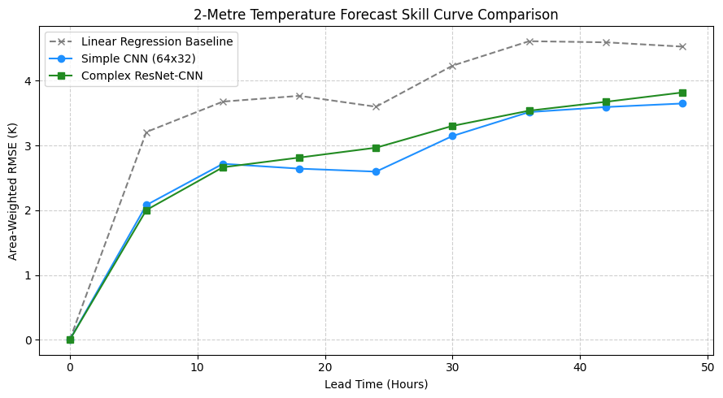

# Phase 0

Before creating this project, I wrote and tested [`notebooks/01_t2m_z500_model_comparison.ipynb`](notebooks/01_t2m_z500_model_comparison.ipynb) on Google Colab.

It compares three models trained on 2018 and tested on 1–15 Jan 2020:

| Model       | Description                                                           |
| ----------- | --------------------------------------------------------------------- |
| Linear      | A single 5×5 periodic convolution, no nonlinearity                    |
| Simple CNN  | 3 conv layers, GELU, residual                                         |
| Complex CNN | ResNet-style blocks plus a dilated block for a larger receptive field |

The CNNs clearly beat the linear model. **But at 24 h they're still worse than simply persisting the initial state** (WB2 persistence T2M RMSE at 24 h: 1.74 K; climatology: 2.40 K). The main reasons: the model has no knowledge of the time of day or season, it sees only two variables, and it was trained only on single steps. The [roadmap](docs/ROADMAP.md) has the full diagnosis and fixes.
