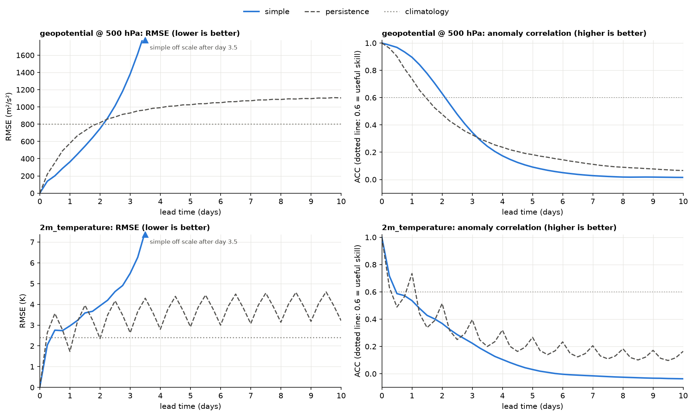

# Phase 1

## Goal

My first [notebook](../../notebooks/01_t2m_z500_model_comparison.ipynb) trained three models on one year (2018) of T2M + Z500 and evaluated them on 48 h predictions over 1–15 Jan 2020.

The goal of Phase 1 is to extend these initial models to the full training set of WeatherBench2 and compare them against real baseline models instead of just themselves.

Steps:

1. Train 1979–2015, validate 2016–2017, test 2020 (with 00z and 12z initializations, so 732 forecasts). Keep it to only the `2m_temperature` and `geopotential@500` for now for quick local training, but extend the prediction rollout to 10 days instead of 2.
2. Look at ACC (anomaly correlation coefficient) for Z500 in addition to RMSE.
3. Plot the best model vs persistence vs climatology over a full year.
4. Explain why climatology's RMSE is flat.
5. Evaluate and explain the results.

## Step 0: Setup local env

Only using 2m temp and z500 means the data is small enough to train locally on my laptop, which is simpler than running on Google Colab.

```sh
# Create the virtual env
uv venv --python 3.12 .venv
source .venv/bin/activate
# Install dependencies with uv
uv pip install -e . -e ../weatherbench2 absl-py
```

## Step 1: Train Full History

Download the data and cache it in [data/era5_64x32](../../data/era5_64x32/) by running:

```sh
python scripts/download_era5.py --channels 2m_temperature geopotential@500 --start-year 1979 --end-year 2020 --output data/era5_64x32
```

Train and validate the simple model on the full data with 10 day windows (took about 10 min to run):

```sh
python scripts/train_and_forecast.py --data data/era5_64x32 --model simple --train-start 1979-01-01 --train-end 2015-12-31 --val-start 2016-01-01 --val-end 2017-12-31 --test-start 2020-01-01 --test-end 2020-12-31 --lead-steps 40 --init-hours 0 12 --epochs 5 --patience 2 --output output/forecast_simple_2mtemp_z500.zarr --checkpoint checkpoints/simple_2mtemp_z500.pt
```

During testing the script is careful to normalize the data using the training data's mean and standard deviation because rescaling the test data with different statistics would change what the data means to the model. It was trained to expect data on the scale from the training data. It also uses the validation data's epochs because if it took them from the test data, it would be biased.

Evaluate (took about 2 hours to run):

```sh
WB2_DIR='../weatherbench2' BASELINES=1 scripts/evaluate.sh output/forecast_simple_2mtemp_z500.zarr evals/results_simple_2mtemp_z500/ 2m_temperature,geopotential 500
```

## Step 2: Anomaly Correlation Coefficient

The anomaly correlation coefficient is used to calculate how well models match observed weather patterns compared to a climatology baseline.
The score ranges from 1 to -1 where 1 is a perfect forecast, 0 roughly matches the climatology baseline, and -1 is a reverse correlation.
A score of 0.6 is considered the threshold for useful models.

Can a forecast have a high ACC but a poor RMSE? Yes. Because ACC measures anomaly patterns but not scale, a forecast that shows the same anomalies as observed but makes them too strong or too weak would have a high ACC but a low RMSE.

## Step 3: Plot the Skill Curve

I created a new script [graph_skill_curves.py](../../scripts/graph_skill_curves.py) to plot the skill curves after the evaluation.

Run it:

```sh
python scripts/graph_skill_curves.py simple=evals/results_simple_2mtemp_z500 --output evals/results_simple_2mtemp_z500/skill_curves.png
```

## Step 4: Explain Why Climatology's Error Is The Same At Every Lead Time

The climatology predictions simply take the average weather for a particular day and time based on the historical data range used, which was 1990 to 2019 in my evaluation. This means the climatology predictions don't use the starting weather at all, so lead time has no effect on them, and the error doesn't grow with lead time. Instead, the error is tied to how much the actual weather on that day deviated from the historical average.

## Step 5: Results

I trained a simple, three-layer, residual CNN model on data from 1979 to 2015 and validated it on 2016-2017 to predict two parameters: temperature in Kelvins 2 meters off the ground and geopotential at 500 hPa. I evaluated it using weatherbench on the observed data from 2020. I then also evaluated a persistence model, where the next day's weather is assumed to look like the day before, and a climatology model, where the weather for a given day is assumed to look like its historical average on that day.

The graph comparing the root-mean-squared error (RMSE) and anomaly correlation coefficient (ACC) for all 3 models across 10-day forecasts is below:



The immediately obvious result is that the error for the model skyrockets after the second day. The reason is probably that it was only trained on single-step changes, so it is not good at performing multiple steps. In training, the model always got accurate ERA5 data as the initial state to make a prediction from. But in the evaluation, in order to predict a 10-day forecast, it makes forty 6-hour predictions with its own faulty predictions as input after the first step. It was never trained to handle this, so the small differences compound and the error quickly explodes.

Below is a sample 10-day forecast for all three models against the ERA5 source of truth started at 8 Feb 2020 00 UTC, when Storm Ciara was headed for northern Europe. The forecast is for a single grid cell centered on 53.4°N, 11.25°E (northern Germany; each cell is ~625 km across).
Values in parentheses are the error (forecast − ERA5).

**2 m temperature (K)**

| Lead    | Valid time (UTC) | ERA5 (truth) | Simple CNN    | Persistence  | Climatology  |
| ------- | ---------------- | ------------ | ------------- | ------------ | ------------ |
| 0 h     | 8 Feb 00:00      | 276.5        | 276.5 (0.0)   | 276.5 (0.0)  | 274.0 (−2.5) |
| 6 h     | 8 Feb 06:00      | 274.9        | 276.1 (+1.2)  | 276.5 (+1.6) | 273.6 (−1.3) |
| 12 h    | 8 Feb 12:00      | 279.3        | 276.1 (−3.2)  | 276.5 (−2.7) | 276.0 (−3.3) |
| 1 day   | 9 Feb 00:00      | 279.1        | 276.6 (−2.5)  | 276.5 (−2.6) | 274.0 (−5.1) |
| 2 days  | 10 Feb 00:00     | 283.1        | 277.0 (−6.1)  | 276.5 (−6.6) | 274.0 (−9.1) |
| 3 days  | 11 Feb 00:00     | 276.8        | 273.6 (−3.2)  | 276.5 (−0.3) | 274.1 (−2.8) |
| 5 days  | 13 Feb 00:00     | 276.1        | 258.8 (−17.3) | 276.5 (+0.5) | 274.1 (−1.9) |
| 10 days | 18 Feb 00:00     | 279.4        | 56.8 (−222.6) | 276.5 (−2.8) | 274.3 (−5.0) |

**Geopotential at 500 hPa (m²/s²)**

| Lead    | Valid time (UTC) | ERA5 (truth) | Simple CNN      | Persistence     | Climatology     |
| ------- | ---------------- | ------------ | --------------- | --------------- | --------------- |
| 0 h     | 8 Feb 00:00      | 55,425       | 55,425 (0)      | 55,425 (0)      | 53,330 (−2,095) |
| 6 h     | 8 Feb 06:00      | 55,185       | 55,239 (+53)    | 55,425 (+240)   | 53,267 (−1,918) |
| 12 h    | 8 Feb 12:00      | 55,011       | 55,101 (+89)    | 55,425 (+414)   | 53,327 (−1,684) |
| 1 day   | 9 Feb 00:00      | 54,364       | 54,712 (+348)   | 55,425 (+1,061) | 53,326 (−1,037) |
| 2 days  | 10 Feb 00:00     | 51,811       | 54,063 (+2,253) | 55,425 (+3,614) | 53,324 (+1,514) |
| 3 days  | 11 Feb 00:00     | 50,668       | 55,070 (+4,402) | 55,425 (+4,757) | 53,324 (+2,656) |
| 5 days  | 13 Feb 00:00     | 52,082       | 53,490 (+1,408) | 55,425 (+3,343) | 53,325 (+1,244) |
| 10 days | 18 Feb 00:00     | 52,866       | 46,583 (−6,282) | 55,425 (+2,559) | 53,342 (+476)   |

The model was better than persistence over the first two days, but by day 10 it forecasted impossible weather conditions. With this temperature example, by day five it was predicting that Germany would be -15C and by day ten it would be -216C, which is clearly not going to happen.

This is why persistence has a limit to its error but the model does not - persistence always forecasts a valid weather state.

More interesting notes from the graph:

- persistence has a distinct diurnal pattern. Error is high every 12 hours but low every 24 hours. This is because persistence maintains the starting state for every step, and every 24 hours the time of day matches the time of day of the starting state, making it more likely to be correct. On the flip side, at 12 hours it is the opposite time of day as the starting state, so if the starting state was at noon when the temperature was high, the 12-hour mark is during the night when temperature is low which gives it a higher error.
- the climatology model is a flat error line. This is due to the reasons explained in step 4 - that the error is unrelated to lead time, only to how the actual weather on that day deviated from the historical average.
- after 2 days, persistence is worse than climatology. This is because the weather after multiple days becomes less and less related to the initial conditions until by 10 they are almost two independent states. Two independent states should differ more from each other than they do from the average state, because most states are only one standard deviation from the average but two standard deviations from each other. Because climatology is always the average, it has a lower error after a few days than persistence.

**Next Steps:**

- add solar inputs so the model knows when it's day and night over particular cells
- use multi-step training to make it more accurate over longer forecast windows and prevent the error blowup
