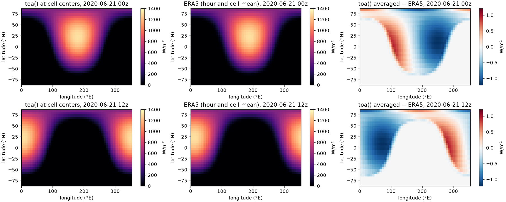

# Phase 2

## Goal

Phase 1 trained the model on the full weather bench dataset from 1979 - 2015 and compared it to persistence and climatology models as benchmarks. It also extended the forecast window from 2 days to 10 days on the `2m_temperature` and `geopotential@500` outputs.

However, it was unable to beat persistence at 24 hours because it did not recognize how time of day plays a role in temperature. The goal of phase 2 is to add forcing inputs like incoming solar radiation so the model can learn to change its outputs with the time of day to achieve more accurate forecasts and beat persistence at 24 hours.

## Step 1: Separate Inputs From Outputs

1. Separated `in_channels` from `out_channels` in [models.py](../../src/wbforecaster/models.py) so they can be different.
2. Kept the residual connection on the state channels only: `x[:, :out_channels] + net(x)`. The model adds its predicted change to the weather it forecasts, not to the forcings, which it never predicts.
3. Modified the dataset to take a forcing tensor and append the forcings for each step to the state as extra input channels, so each sample is still an `(input, target)` pair and the training loop doesn't change.
4. The training script now builds models with `in_channels` and `out_channels` and saves both in the checkpoint. Until the forcings exist, both equal the number of state channels.

## Step 2: Forcing Functions

[forcings.py](../../src/wbforecaster/forcings.py) computes 9 forcing channels for the 6-hour step starting at each time:

| Channel                | What it tells the model                                                                                                        |
| ---------------------- | ------------------------------------------------------------------------------------------------------------------------------ |
| `toa_t`, `toa_t+6h`    | incoming solar radiation at the top of the atmosphere at the start and end of the step, divided by the solar constant (0–1.03) |
| `sin_hour`, `cos_hour` | UTC time of day                                                                                                                |
| `sin_year`, `cos_year` | time of year                                                                                                                   |
| `land_sea_mask`        | land (1) or sea (0)                                                                                                            |
| `orography`            | surface height (`geopotential_at_surface`), z-scored                                                                           |
| `sin_lat`              | latitude                                                                                                                       |

TOA is computed from solar geometry rather than read from ERA5, so it's known at any future time during a rollout. Both the start and end of the step are included so the model can tell whether the sun is rising or setting.

`Forcings` computes the channels on demand (~0.1 ms per sample) instead of storing them: precomputed for 1979–2015 they would take ~4 GB. Indexing it returns a `(9, 32, 64)` tensor, so it plugs into `OneStepDataset` as the forcing tensor, and `Forcings.at(times)` computes them for any times, which the rollout will need.

### Checking it against ERA5

```sh
python scripts/check_toa.py --output docs/images/phase2_toa.png
```



The difference panels are scaled to the largest error shown (about 1.2 W/m²). `toa()` comes out slightly too high on the morning side of the daylit area and slightly too low on the afternoon side, which is the pattern a small timing offset produces. The sun's position changes TOA by up to ~6 W/m² per minute, so 1.2 W/m² is roughly a 10–15 second difference from ERA5's solar calculation.

## Step 3: Latitude-Weighted Loss

The 64x32 grid has 64 cells in every latitude row, but a row near the pole covers far less of the globe than a row at the equator. Plain MSE counts every cell equally, so it spends as much effort on the tiny polar cells as on the huge tropical ones. WB2 weights each row by its area when scoring, so the model was being trained on a different objective from the one it's graded on.

`LatWeightedMSE` in [forecast.py](../../src/wbforecaster/forecast.py) multiplies each squared error by its row's area weight before averaging. The weights come from `lat_weights`, which uses WB2's own formula, the area of the row's cells (sin(upper edge) − sin(lower edge)), normalized to mean 1. On this grid that's practically identical to cos(latitude). An error in the polar row now costs ~5% of the same error at the equator. Because the weights average to 1, the loss stays on the same scale as plain MSE. Turn it on with `--lat-weighted-loss`. Validation uses the same loss, so the best epoch is picked by the weighted score.

## Step 4: Train and Compare

I want to train the model with each combination of the new features to see how they improve the forecasts:

- with forcing parameters
- with lat-weighted loss
- with both forcing parameters and lat-weighted loss

The fourth combination, neither, is the Phase 1 model. It was trained with exactly the same settings (and the same code path: no forcings, plain MSE), so its results in `evals/results_simple_2mtemp_z500` serve as the baseline without retraining.

With forcing parameters only:

```sh
python scripts/train_and_forecast.py --data data/era5_64x32 --model simple --train-start 1979-01-01 --train-end 2015-12-31 --val-start 2016-01-01 --val-end 2017-12-31 --test-start 2020-01-01 --test-end 2020-12-31 --lead-steps 40 --init-hours 0 12 --epochs 5 --patience 2 --output output/phase2/forecast_simple_2mtemp_z500_forcing.zarr --checkpoint checkpoints/phase2/simple_2mtemp_z500_forcing.pt
```

With lat-weighted loss only:

```sh
python scripts/train_and_forecast.py --data data/era5_64x32 --model simple --train-start 1979-01-01 --train-end 2015-12-31 --val-start 2016-01-01 --val-end 2017-12-31 --test-start 2020-01-01 --test-end 2020-12-31 --lead-steps 40 --init-hours 0 12 --epochs 5 --patience 2 --output output/phase2/forecast_simple_2mtemp_z500_latloss.zarr --checkpoint checkpoints/phase2/simple_2mtemp_z500_latloss.pt --lat-weighted-loss --no-forcings
```

With both:

```sh
python scripts/train_and_forecast.py --data data/era5_64x32 --model simple --train-start 1979-01-01 --train-end 2015-12-31 --val-start 2016-01-01 --val-end 2017-12-31 --test-start 2020-01-01 --test-end 2020-12-31 --lead-steps 40 --init-hours 0 12 --epochs 5 --patience 2 --output output/phase2/forecast_simple_2mtemp_z500_both.zarr --checkpoint checkpoints/phase2/simple_2mtemp_z500_both.pt --lat-weighted-loss
```

Then I need to evaluate all three variations.

First, cache the ERA5 truth and climatology the evaluation scores against (once, ~40 MB, ~1 minute). Phase 1's evaluation streamed them from GCS: WB2 scores one forecast start time at a time, and each one re-downloaded 100-timestep chunks holding all 13 pressure levels. With the cache, `evaluate.sh` reads only 2020, T2M and Z500 from local disk. Re-scoring the Phase 1 forecast this way took 18 seconds instead of ~40 minutes, and gave the same scores to floating-point precision (persistence and climatology too). The gcsfs "Could not determine bucket type" warnings go away as well, since nothing is read from GCS.

```sh
python scripts/cache_eval_data.py --start 2020-01-01 --end 2020-12-31 --variables 2m_temperature geopotential --levels 500
```

Persistence and climatology don't depend on the model, so their scores would be identical for every run, and Phase 1 already computed them for the same test period and initialization times (`evals/results_simple_2mtemp_z500/persistence` and `climatology`). So the commands leave out `BASELINES=1`:

```sh
WB2_DIR='../weatherbench2' scripts/evaluate.sh output/phase2/forecast_simple_2mtemp_z500_forcing.zarr evals/phase2/simple_2mtemp_z500_forcing/ 2m_temperature,geopotential 500
```

```sh
WB2_DIR='../weatherbench2' scripts/evaluate.sh output/phase2/forecast_simple_2mtemp_z500_latloss.zarr evals/phase2/simple_2mtemp_z500_latloss/ 2m_temperature,geopotential 500
```

```sh
WB2_DIR='../weatherbench2' scripts/evaluate.sh output/phase2/forecast_simple_2mtemp_z500_both.zarr evals/phase2/simple_2mtemp_z500_both/ 2m_temperature,geopotential 500
```

Finally, plot all four variants on the same axes. The baselines are picked up automatically from the Phase 1 results directory:

```sh
python scripts/graph_skill_curves.py phase1=evals/results_simple_2mtemp_z500 forcing=evals/phase2/simple_2mtemp_z500_forcing latloss=evals/phase2/simple_2mtemp_z500_latloss both=evals/phase2/simple_2mtemp_z500_both --output docs/images/phase2_skill_curves.png
```
